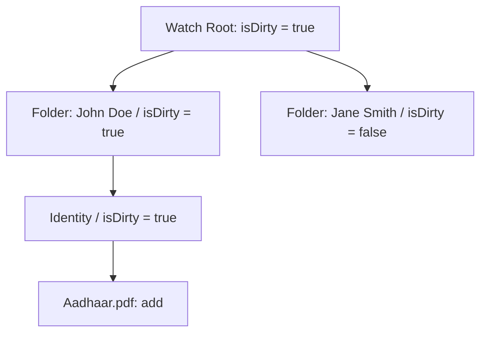

# 🧠 GoaOnAuto — Deep Code Logic & Algorithmic Blueprint

> **In-Depth Mathematical, Algorithmic & Business Logic Breakdown for All Core Functions**  
> Explains how the Trie change buffer works, how BigInt/Gzip Aadhaar QR decoding works, how multi-document dossier synthesis deduces residency, how ASP.NET WebForms postback quirks were solved, and how computer vision heuristics operate.

---

## 📑 Table of Contents

1. [Ingestion & File System Watcher Logic](#1-ingestion--file-system-watcher-logic)
   - [Trie Change Accumulator & Dirty-Bit Propagation](#trie-change-accumulator--dirty-bit-propagation)
   - [Hardware Telemetry & CPU Tick Math](#hardware-telemetry--cpu-tick-math)
   - [File Write Stability & I/O Quiescence](#file-write-stability--io-quiescence)
2. [GPU Vision & Document Intelligence Logic](#2-gpu-vision--document-intelligence-logic)
   - [Aadhaar QR Decoding: Legacy XML vs. Compressed Secure V2/V3](#aadhaar-qr-decoding-legacy-xml-vs-compressed-secure-v2v3)
   - [Verhoeff Modulo-10 Checksum Algorithm](#verhoeff-modulo-10-checksum-algorithm)
   - [Persistent GPU VRAM Management & Batching](#persistent-gpu-vram-management--batching)
   - [Face Detection & Signature Alpha Channel Isolation](#face-detection--signature-alpha-channel-isolation)
   - [Optical Disambiguation & Spell Correction Dictionary](#optical-disambiguation--spell-correction-dictionary)
3. [Classification & Dossier Synthesis Logic](#3-classification--dossier-synthesis-logic)
   - [Weighted Multi-Rule Document Classification](#weighted-multi-rule-document-classification)
   - [Chronological Age Math & Date-of-Birth Deduction](#chronological-age-math--date-of-birth-deduction)
   - [Residency Duration Deduction from Spans & Bonafides](#residency-duration-deduction-from-spans--bonafides)
   - [Golden Source vs. OCR Precedence Tiering](#golden-source-vs-ocr-precedence-tiering)
4. [Web Portal Automation & ASP.NET WebForms Quirks](#4-web-portal-automation--aspnet-webforms-quirks)
   - [Browser Sandbox Enforcement & Profile Lock Hygiene](#browser-sandbox-enforcement--profile-lock-hygiene)
   - [Citizen Authentication Detection Multi-Check Algorithm](#citizen-authentication-detection-multi-check-algorithm)
   - [The "Proceed to Apply" ASP.NET PostBack Problem & Solution](#the-proceed-to-apply-aspnet-postback-problem--solution)
   - [Cascading AJAX Dropdown Synchronization & Modal Dialogs](#cascading-ajax-dropdown-synchronization--modal-dialogs)
   - [Automated CAPTCHA Image Processing](#automated-captcha-image-processing)

---

## 1. Ingestion & File System Watcher Logic

### Trie Change Accumulator & Dirty-Bit Propagation
* **Source**: [`src/watcher/directoryBuffer.ts`](file:///c:/Users/Anosh/Documents/Notes/Projects/goaOnAuto/src/watcher/directoryBuffer.ts)
* **Problem**: When users drop entire folders of applicant documents (or sync them via Google Drive), hundreds of low-level `fs.watch` events fire out-of-order. Processing them naively causes race conditions and partial file reads.
* **Algorithmic Solution**:
  1. A Prefix Tree (Trie) is instantiated with the root directory as the tree base.
  2. Each folder level maps to a `DirectoryNode`.
  3. When `markChange(filePath, eventType)` is called:
     * The path relative to root is broken into path segments: `["Client_John", "Aadhaar.pdf"]`.
     * Intermediate `DirectoryNode`s are created on-the-fly if not already present in `node.children` (`Map<string, DirectoryNode>`).
     * The target file record is added to the leaf node's `changedFiles` map with timestamp `Date.now()`.
     * `node.hasDirectChanges = true`.
     * **Dirty-Bit Propagation**: `setDirty()` traverses upwards along parent pointers (`while (current) { current.isDirty = true; current = current.parent; }`), flagging the entire ancestor chain as dirty in $O(\text{depth})$ time.
  4. **Depth-First Search (DFS) Batch Harvesting**: `getChangesDFS(root)` traverses dirty branches only, pruning clean subtrees in $O(1)$, and returns only leaf/client directories that have recorded direct mutations.



---

### Hardware Telemetry & CPU Tick Math
* **Source**: [`src/watcher/systemGovernor.ts`](file:///c:/Users/Anosh/Documents/Notes/Projects/goaOnAuto/src/watcher/systemGovernor.ts)
* **Goal**: Ensure the batch worker never exhausts host RAM or freezes UI response on the local machine during heavy CUDA tensor executions.
* **Mathematical Calculation**:
  * Free RAM is read via `os.freemem()` and verified against threshold $\text{RAM}_{\text{free}} \ge 3.0\text{ GB}$.
  * CPU load is derived across all logical cores by inspecting instantaneous CPU execution times:
    $$\text{totalTick} = \sum_{\text{cores}} (\text{user} + \text{nice} + \text{sys} + \text{idle} + \text{irq})$$
    $$\text{idlePercent} = \frac{\sum_{\text{cores}} \text{idle}}{\text{totalTick}} \times 100$$
    $$\text{CPU}_{\text{usage}} = 100 - \text{idlePercent}$$
  * If $\text{CPU}_{\text{usage}} > 80\%$ or $\text{RAM}_{\text{free}} < 3.0\text{ GB}$, `ensureResourceAvailability()` initiates an asynchronous polling loop sleeping $1000\text{ms}$ per iteration until the hardware satisfies requirements or reaches `maxWaitMs` (default $15,000\text{ms}$).

---

### File Write Stability & I/O Quiescence
* **Source**: [`src/watcher/fileSyncReady.ts`](file:///c:/Users/Anosh/Documents/Notes/Projects/goaOnAuto/src/watcher/fileSyncReady.ts)
* **Logic**: Before processing any file, `isFileWriteComplete(filePath)` checks file size at $t_0$, waits $300\text{ms}$, and checks size at $t_1$.
  * If $\text{size}(t_1) \neq \text{size}(t_0)$ or $\text{size} = 0$, the file is still being transferred (e.g. scanner actively writing image or cloud sync uploading chunk).
  * The file is held in the buffer until 2 consecutive reads match, ensuring zero corrupted or half-written PDF/JPEG reads.

---

## 2. GPU Vision & Document Intelligence Logic

### Aadhaar QR Decoding: Legacy XML vs. Compressed Secure V2/V3
* **Source**: [`python/vision/aadhaar_qr.py`](file:///c:/Users/Anosh/Documents/Notes/Projects/goaOnAuto/python/vision/aadhaar_qr.py)
* **Context**: UIDAI uses two radically different QR code standards:
  1. **Legacy XML**: Plaintext or simple Base64-wrapped XML string (`<PrintLetterBarcodeData ...>`).
  2. **Secure e-Aadhaar V2/V3**: A 2048-bit digitally signed, GZIP-compressed binary payload encoded as a giant Base10 BigInteger string (often exceeding 1,200 digits).

```mermaid
flowchart TD
    Scan[QR Code Detected by pyzbar / zxingcpp] --> Raw{Check Text Representation}
    Raw -->|Starts with <PrintLetterBarcodeData| Legacy[Parse Legacy XML via RegEx]
    Raw -->|Base10 BigInt Digits > 1000| BigInt[Convert Base10 String to Raw Bytes]
    BigInt --> Magic[Search for Gzip Magic Bytes: 1f 8b 08]
    Magic --> Decomp[zlib.decompress with sliding window bits: MAX_WBITS | 16]
    Decomp --> Split[Split Byte Stream by 0xFF Delimiter]
    Split --> Extract[Extract Golden Source: Name, DOB, Gender, Address]
```

#### Detailed Decompression Logic:
1. **BigInt Byte Conversion**:
   ```python
   big_int = int(raw_text)
   qr_bytes = big_int.to_bytes((big_int.bit_length() + 7) // 8, byteorder='big')
   ```
2. **Locating Gzip Magic Bytes**:
   The QR contains ~255 to 256 bytes of RSA digital signature followed by the compressed payload. The code dynamically searches for the standard GZIP header bytes `\x1f\x8b\x08`.
3. **Multi-Window Zlib Decompression**:
   Tries three distinct window bit configurations to handle header discrepancies across UIDAI variants:
   * `zlib.decompress(payload, wbits=zlib.MAX_WBITS | 16)` (Standard Gzip wrapper)
   * `zlib.decompress(payload, wbits=zlib.MAX_WBITS | 32)` (Auto-detect zlib or gzip header)
   * `zlib.decompress(payload, wbits=-zlib.MAX_WBITS)` (Raw deflate without header)
4. **Delimited Field Splitting**:
   The decompressed stream separates fields with byte `255` (`\xff`).
   * Field `2`: Full Name
   * Field `3`: Date of Birth (`DD-MM-YYYY`)
   * Field `4`: Gender (`M` / `F` / `T`)
   * Field `5`: Care Of (`S/O`, `D/O`, `W/O`)
   * Fields `6-14`: District, Landmark, House No, Locality, Pincode, Post Office, State, Taluka, Village.

---

### Verhoeff Modulo-10 Checksum Algorithm
* **Source**: [`src/classifier/dossierExtractor.ts`](file:///c:/Users/Anosh/Documents/Notes/Projects/goaOnAuto/src/classifier/dossierExtractor.ts)
* **Logic**: Indian Aadhaar numbers use the dihedral group $D_5$ permutation algorithm (Verhoeff checksum).
* Aadhaar numbers **never** begin with `0` or `1`, must be exactly 12 digits, and pass check table validation. The extractor asserts these invariants before assigning confidence `1.0` to UID candidates.

---

### Persistent GPU VRAM Management & Batching
* **Source**: [`python/daemons/gpu_worker_daemon.py`](file:///c:/Users/Anosh/Documents/Notes/Projects/goaOnAuto/python/daemons/gpu_worker_daemon.py)
* **Goal**: PyTorch model loading takes 2–4 seconds per document if invoked ad-hoc.
* **Persistent Architecture**:
  * The daemon launches once and keeps weights resident in GPU memory.
  * **Memory Cap Enforcement**:
    ```python
    torch.cuda.set_per_process_memory_fraction(0.90, 0)
    ```
  * Line-buffered JSON-RPC over Windows Named Pipes (`\\.\pipe\goaonauto_ipc`) processes batches of document crops sequentially through GPU tensors without unloading models.

---

### Face Detection & Signature Alpha Channel Isolation
* **Source**: [`python/vision/photo_detector.py`](file:///c:/Users/Anosh/Documents/Notes/Projects/goaOnAuto/python/vision/photo_detector.py), [`signature_detector.py`](file:///c:/Users/Anosh/Documents/Notes/Projects/goaOnAuto/python/vision/signature_detector.py)
* **Heuristic Trigger**: When OCR returns $<35$ characters, the image is tested for passport photo or signature features.
* **Passport Photo Logic**:
  * OpenCV YuNet ONNX face detection isolates face bounding boxes.
  * Validates portrait aspect ratio (height > width, ratio roughly $3.5\text{ cm} \times 4.5\text{ cm} \approx 0.77$).
  * Asserts face coverage occupies between $40\%$ and $75\%$ of overall image area.
* **Signature Detection Logic**:
  * Converts image to HSV color space and isolates blue and black ink ranges (`H: 100-130, S: 50-255, V: 50-255` for blue ballpoint ink).
  * Runs Otsu thresholding and contour analysis.
  * Calculates stroke aspect ratio and bounding box stroke density.
  * Converts dark ink strokes to a 4-channel RGBA texture, making background paper pixels completely transparent (`alpha = 0`) for clean placement on LaTeX affidavit templates.

---

### Optical Disambiguation & Spell Correction Dictionary
* **Source**: [`src/scanner/ocrPostProcessor.ts`](file:///c:/Users/Anosh/Documents/Notes/Projects/goaOnAuto/src/scanner/ocrPostProcessor.ts)
* **Logic**: OCR models frequently confuse optical twins in numeric contexts:
  * Letter `O` vs. Digit `0` (e.g. `O1/O5/2004` $\rightarrow$ `01/05/2004`).
  * Lowercase `l` / uppercase `I` vs. Digit `1`.
  * Letter `S` vs. Digit `5`.
  * Letter `B` vs. Digit `8`.
* **Processing Chain**:
  1. **Regex Pattern Passes**: Executes regex patterns defined in `dataset/ocr_spell_corrections.json` targeting date spans, pincodes, and certificate numbers.
  2. **Word Boundary Substitutions**: Applies learned whole-word corrections using escaped regex `\b${word}\b`.
  3. **Continuous Learning**: When an operator corrects text in the OCR Trainer GUI, `recordSpellCorrection()` writes the mapping back to JSON and invalidates the in-memory cache.

---

## 3. Classification & Dossier Synthesis Logic

### Weighted Multi-Rule Document Classification
* **Source**: [`src/classifier/documentClassifier.ts`](file:///c:/Users/Anosh/Documents/Notes/Projects/goaOnAuto/src/classifier/documentClassifier.ts), [`rules.ts`](file:///c:/Users/Anosh/Documents/Notes/Projects/goaOnAuto/src/classifier/rules.ts)
* **Algorithm**:
  For each document class $C$ (e.g. `residence_cert`, `birth_cert`, `bonafide_cert`):
  $$\text{Score}(C) = \sum_{k \in \text{Keywords}} w_k \cdot \text{count}(k) + \text{Bonus}_{\text{filename}} - \sum_{e \in \text{Exclusions}} p_e \cdot \text{count}(e)$$
  * **Mandatory Tokens**: If a rule specifies `requiredTokens` (e.g., `"UNIQUE IDENTIFICATION AUTHORITY OF INDIA"` for Aadhaar), the document *must* contain at least one required token, or its score drops to zero.
  * **Exclusion Penalties**: Heavy negative weights prevent false positives (e.g., the presence of `"BIRTH"` or `"DEATH"` penalizes `residence_cert`).
  * The category with the highest normalized score exceeding minimum threshold is selected.

---

### Chronological Age Math & Date-of-Birth Deduction
* **Source**: [`src/classifier/dossierExtractor.ts`](file:///c:/Users/Anosh/Documents/Notes/Projects/goaOnAuto/src/classifier/dossierExtractor.ts)
* **Function**: `calculateAgeFromDob(dobStr)`
* **Parsing Regexes**:
  1. `DD/MM/YYYY`, `DD-MM-YYYY`, `DD.MM.YYYY`:
     ```typescript
     const birthDate = new Date(year, month - 1, day);
     let age = today.getFullYear() - birthDate.getFullYear();
     const m = today.getMonth() - birthDate.getMonth();
     if (m < 0 || (m === 0 && today.getDate() < birthDate.getDate())) age--;
     ```
  2. `YYYY-MM-DD`: Parses ISO date format.
  3. 4-digit Year only (`YYYY`): Estimates $\text{age} = \text{currentYear} - \text{year}$.
* **Boundary Guard**: Validates $0 \le \text{age} \le 130$. Values outside this range return `undefined`.

---

### Residency Duration Deduction from Spans & Bonafides
* **Source**: [`src/classifier/dossierExtractor.ts`](file:///c:/Users/Anosh/Documents/Notes/Projects/goaOnAuto/src/classifier/dossierExtractor.ts)
* **Goal**: Establish the continuous 15-year residency requirement for Goa Certificate REV05.
* **Extraction Heuristics**:
  1. **Direct Duration Matches**:
     `/(?:for|past|last)\s+(?:the\s+)?(?:past|last)?\s*(\d{1,2})\s*years?/`
     Extracts values like `"for the last 15 years"` $\rightarrow 15$. Confidence: `0.9`.
  2. **Since-Year Matches**:
     `/since\s+(?:the\s+year\s+)?(19\d{2}|20\d{2})/`
     Calculates $\text{years} = \text{currentYear} - \text{matchedYear}$. Confidence: `0.85`.
  3. **Bonafide / Marksheet Date Spans**:
     `/from\s+(20\d{2})\s+to\s+(20\d{2})/`
     Calculates $\text{duration} = \text{endYear} - \text{startYear}$. Confidence: `0.8`.

---

### Golden Source vs. OCR Precedence Tiering
* **Synthesis Hierarchy**:
  * **Tier 1 (Golden Source)**: Aadhaar QR code demographic payload. Confidence `1.0`. QR name, DOB, gender, and address components always override OCR extractions.
  * **Tier 2 (OCR Fallbacks)**: Used only when fields are absent from QR (e.g. years in Goa, previous certificate numbers, parent relations from birth certificates).
  * The unified dossier is exported to `applicant_dossier.json`.

---

## 4. Web Portal Automation & ASP.NET WebForms Quirks

### Browser Sandbox Enforcement & Profile Lock Hygiene
* **Source**: [`src/automation/services/portalSessionManager.ts`](file:///c:/Users/Anosh/Documents/Notes/Projects/goaOnAuto/src/automation/services/portalSessionManager.ts)
* **Profile Lock Recovery**:
  When browser automation terminates abruptly, Chromium leaves behind lock files (`SingletonLock`, `SingletonCookie`, `SingletonSocket`). On startup, `launchBravePortalContext()` automatically unlinks these stale lockfiles to prevent "Profile in use" crashes on reruns.
* **Eliminating Security Infobars**:
  By setting `chromiumSandbox: true` and passing `ignoreDefaultArgs: ['--no-sandbox']`, Brave launches cleanly without triggering Chromium's yellow `"You are using an unsupported command-line flag --no-sandbox"` security warning.

---

### Citizen Authentication Detection Multi-Check Algorithm
* **Function**: `isUserLoggedIn(page: Page): Promise<boolean>`
* **The Challenge**: GoaOnline redirects across complex ASP.NET URLs. Simply checking whether the domain is `goaonline.gov.in` leads to false positive login detections.
* **5-Step Guard Evaluation**:
  1. **URL Exclusion**: If URL contains `/public/login`, `/public/register`, `/public/forgotpassword`, or is `about:blank`, return `false`.
  2. **Password Field Check**: If any `input[type="password"]` exists in the DOM, return `false`.
  3. **Header Link Check**: If header login buttons (`#hlkLogin`, `a[href*="/Public/Login"]`) are present, return `false`.
  4. **Positive DOM Indicator**: Checks for logout anchors (`#hlkLogout`, `a[href*="logout"]`) or user profile containers (`#userMenuBox`, `.user-name`).
  5. **Session Cookie Validation**: Confirms the presence of an active `.ASPXAUTH` authentication token with length $>20$ bytes.

---

### The "Proceed to Apply" ASP.NET PostBack Problem & Solution
* **The Bug**: Clicking the "Proceed to Apply" anchor (`#cphBody_gvService_lnkProceedApply_0`) using standard Playwright `locator.click()` sends synthetic Chrome DevTools Protocol (CDP) mouse coordinates. Because the anchor uses a `javascript:__doPostBack(...)` pseudoprotocol URL, Chromium treats CDP synthetic events on `javascript:` anchors as untrusted navigation gestures. The page remained stuck on the overview page without navigating.
* **The Engine Solution**:
  1. Employs `page.evaluate()` to execute the click and event dispatching directly inside the page's native JavaScript execution context:
     ```javascript
     const el = document.querySelector('#cphBody_gvService_lnkProceedApply_0');
     if (el) {
       el.click();
     } else if (window.__doPostBack) {
       window.__doPostBack('ctl00$cphBody$gvService$ctl02$lnkProceedApply', '');
     }
     ```
  2. Subscribes `page.on('dialog')` before the click to auto-accept confirmation alerts.
  3. Polls context pages for navigation away from `/deptServices` to the application form URL (`services.goaonline.gov.in/GS/...`).

---

### Cascading AJAX Dropdown Synchronization & Modal Dialogs
* **Source**: [`src/automation/pages/residenceFormPage.ts`](file:///c:/Users/Anosh/Documents/Notes/Projects/goaOnAuto/src/automation/pages/residenceFormPage.ts)
* **The Problem**: GoaOnline's residential address modal is an ASP.NET AJAX UpdatePanel. Selecting a District triggers a server round-trip that asynchronously rebuilds the Taluka `<select>` element. Selecting a Taluka then asynchronously rebuilds the Village `<select>`.
* **Synchronization Logic**:
  ```typescript
  // 1. Select District
  await page.selectOption('#id47', { label: data.district });
  // 2. Wait for Taluka dropdown to repopulate and exit disabled state
  await page.waitForFunction(() => {
    const taluka = document.querySelector('#id48') as HTMLSelectElement;
    return taluka && taluka.options.length > 1 && !taluka.disabled;
  }, null, { timeout: 10000 });
  // 3. Select Taluka
  await page.selectOption('#id48', { label: data.taluka });
  // 4. Wait for Village dropdown to repopulate
  await page.waitForFunction(() => {
    const village = document.querySelector('#id49') as HTMLSelectElement;
    return village && village.options.length > 1 && !village.disabled;
  }, null, { timeout: 10000 });
  // 5. Select Village
  await page.selectOption('#id49', { label: data.village });
  ```

---

### Automated CAPTCHA Image Processing
* **Source**: [`src/automation/solver/captchaSolver.ts`](file:///c:/Users/Anosh/Documents/Notes/Projects/goaOnAuto/src/automation/solver/captchaSolver.ts)
* **Logic**:
  1. Captures the bounding box screenshot of the CAPTCHA image element.
  2. Applies grayscale conversion, contrast stretching, and Otsu thresholding to remove background noise lines.
  3. Runs OCR with a character whitelist (`0123456789ABCDEFGHIJKLMNOPQRSTUVWXYZabcdefghijklmnopqrstuvwxyz`).
  4. Returns the predicted text and auto-populates the portal input field.
