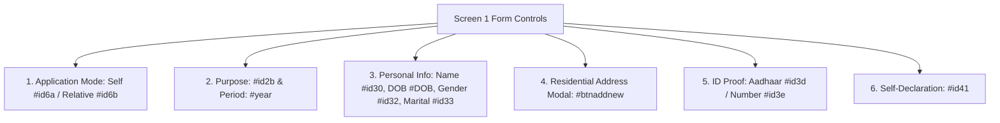

# 🎨 GoaOnAuto — UI Components & Design System Architecture

> **Complete Specification of Raylib Desktop Immediate-Mode GUIs & Web Portal Automation DOM Overlays**  
> Details the Dracula theme design tokens, High-DPI font rendering, custom Raylib widgets, window-in-window architectures, and injected web automation HUDs.

---

## 📑 Table of Contents

1. [Dual-Interface Architecture Overview](#1-dual-interface-architecture-overview)
2. [Raylib Desktop GUI System (`python/gui/core/`)](#2-raylib-desktop-gui-system-pythonguicore)
   - [Immediate-Mode GUI (IMGUI) Paradigm](#immediate-mode-gui-imgui-paradigm)
   - [High-DPI Font Atlas & Crisp Bilinear Typography (`fonts.py`)](#high-dpi-font-atlas--crisp-bilinear-typography-fontspy)
   - [Dracula Design Tokens & Color Palette (`colors.py`)](#dracula-design-tokens--color-palette-colorspy)
   - [Reusable Widget Library (`widgets.py`)](#reusable-widget-library-widgetspy)
   - [Native Windows File Dialogs (`dialogs.py`)](#native-windows-file-dialogs-dialogspy)
   - [Subprocess LaTeX Compilation Engine (`latex_compiler.py`)](#subprocess-latex-compilation-engine-latex_compilerpy)
3. [Raylib Desktop Applications Breakdown (`python/gui/`)](#3-raylib-desktop-applications-breakdown-pythongui)
   - [Affidavit Declarations Studio (`declaration_app.py`)](#affidavit-declarations-studio-declaration_apppy)
   - [Dynamic Signature Scaler Component](#dynamic-signature-scaler-component)
   - [OCR Trainer Studio: Window-in-Window 3-Pane Architecture (`ocr_trainer_gui.py`)](#ocr-trainer-studio-window-in-window-3-pane-architecture-ocr_trainer_guipy)
   - [Interactive Background Matting Canvas (`bg_remover_gui.py`)](#interactive-background-matting-canvas-bg_remover_guipy)
   - [Human Review Confirmation Dialog (`confirmation_gui.py`)](#human-review-confirmation-dialog-confirmation_guipy)
   - [Background Processing Queue Monitor (`progress_gui.py`)](#background-processing-queue-monitor-progress_guipy)
4. [Web Portal UI & DOM Components (`src/automation/`)](#4-web-portal-ui--dom-components-srcautomation)
   - [GoaOnline REV05 Screen 1 DOM Architecture](#goaonline-rev05-screen-1-dom-architecture)
   - [Injected In-Page Dracula Status Pill Overlay](#injected-in-page-dracula-status-pill-overlay)
   - [Visual Simulation Action Tracker & Click Ripples](#visual-simulation-action-tracker--click-ripples)
   - [Residential Address Modal & Cascading AJAX Dropdowns](#residential-address-modal--cascading-ajax-dropdowns)

---

## 1. Dual-Interface Architecture Overview

GoaOnAuto features two distinct UI presentation layers:
1. **Desktop Layer (Immediate-Mode Raylib / PyRay)**: High-performance 60 FPS desktop applications for human review, interactive OCR training, photo background removal, and legal affidavit customization.
2. **Browser Layer (Injected DOM HUD & Playwright POM)**: Non-intrusive in-browser overlays injected directly into live GoaOnline government portal sessions to give human operators visual feedback during headless/headed automation.

```
┌──────────────────────────────────────┐     ┌──────────────────────────────────────┐
│       Raylib Desktop Layer           │     │          Web Portal Layer            │
│  - PyRay 6.0 Immediate-Mode Engine   │     │  - Brave Browser (Chromium Engine)   │
│  - Dracula Color Palette Tokens      │     │  - Injected Floating Dracula Pill    │
│  - High-DPI JetBrains Mono Atlas     │     │  - Visual Simulation Tracker HUD     │
│  - Scissor-Clipped Interactive Cards │     │  - 59-Control DOM Page Object Model  │
└──────────────────────────────────────┘     └──────────────────────────────────────┘
```

---

## 2. Raylib Desktop GUI System (`python/gui/core/`)

### Immediate-Mode GUI (IMGUI) Paradigm
Unlike retained-mode GUI frameworks (Electron, Qt, WPF) that manage complex widget trees and DOM node lifecycles, Raylib operates in **Immediate Mode**:
* Every single frame ($60\text{ FPS}$), the UI layout is recalculated, measured, and drawn from scratch based on current application state.
* **Benefits**:
  * Near-zero memory footprint ($<30\text{ MB}$ RAM vs $>400\text{ MB}$ for Electron).
  * Direct GPU texture binding and hardware scissor clipping.
  * Instantaneous reaction to dynamic window resizing without layout reflow glitches.

---

### High-DPI Font Atlas & Crisp Bilinear Typography (`fonts.py`)
* **Source**: [`python/gui/core/fonts.py`](file:///c:/Users/Anosh/Documents/Notes/Projects/goaOnAuto/python/gui/core/fonts.py)
* **The High-DPI Challenge**: Default Raylib bitmap fonts appear pixelated and blurry when rendered on modern 1080p, 1440p, or 4K Windows displays with $125\%–200\%$ OS scaling.
* **The Solution**:
  1. **48pt Base Texture Atlas**: Fonts are loaded at a high base size ($48\text{pt}$) using `rl.load_font_ex()`.
  2. **Bilinear Texture Filtering**:
     ```python
     rl.set_texture_filter(font.texture, rl.TEXTURE_FILTER_BILINEAR)
     ```
     Enables hardware bilinear interpolation on the font atlas texture, preserving razor-sharp character glyphs when downscaled to UI sizes ($14\text{pt}$ to $24\text{pt}$).
  3. **Fallback Resolution Chain**: Searches project assets (`assets/fonts/JetBrainsMono-Regular.ttf`), user `AppData` local fonts, and standard Windows system fonts (`cascadiacode.ttf`, `consola.ttf`, `segoeui.ttf`).
  4. **Sub-Pixel Text Measurement**: `measure_text_clean()` computes exact float horizontal dimensions via `rl.measure_text_ex()`, enabling pixel-perfect text centering.

---

### Dracula Design Tokens & Color Palette (`colors.py`)
* **Source**: [`python/gui/core/colors.py`](file:///c:/Users/Anosh/Documents/Notes/Projects/goaOnAuto/python/gui/core/colors.py)
* Consistent, eye-friendly dark mode tokens applied across all Raylib desktop windows:

| Token Name | Hex Code | Raylib Color `(R, G, B, A)` | Usage in UI |
| :--- | :--- | :--- | :--- |
| **`DRACULA_BG`** | `#282a36` | `(40, 42, 54, 255)` | Window background canvas |
| **`DRACULA_CURRENT_LINE`** | `#44475a` | `(68, 71, 90, 255)` | Card backgrounds, recessed panels |
| **`DRACULA_FG`** | `#f8f8f2` | `(248, 248, 242, 255)` | Primary text, titles, labels |
| **`DRACULA_COMMENT`** | `#6272a4` | `(98, 114, 164, 255)` | Borders, divider lines, placeholders |
| **`DRACULA_CYAN`** | `#8be9fd` | `(139, 233, 253, 255)` | Active state accents, info badges |
| **`DRACULA_GREEN`** | `#50fa7b` | `(80, 250, 123, 255)` | Primary action buttons (`Save`, `Generate`) |
| **`DRACULA_ORANGE`** | `#ffb86c` | `(255, 184, 108, 255)` | Warnings, star ratings |
| **`DRACULA_PINK`** | `#ff79c6` | `(255, 121, 198, 255)` | Secondary accents, mode indicators |
| **`DRACULA_PURPLE`** | `#bd93f9` | `(189, 147, 249, 255)` | Focus rings, headers, brand accents |
| **`DRACULA_RED`** | `#ff5555` | `(255, 85, 85, 255)` | Delete buttons, errors, missing fields |
| **`DRACULA_YELLOW`** | `#f1fa8c` | `(241, 250, 140, 255)` | Live OCR stream line numbers |

---

### Reusable Widget Library (`widgets.py`)
* **Source**: [`python/gui/core/widgets.py`](file:///c:/Users/Anosh/Documents/Notes/Projects/goaOnAuto/python/gui/core/widgets.py)

#### 1. `draw_button`
Renders an interactive, rounded button protected against text overflow:
* **Dynamic Hover Alpha**: Uses `rl.color_alpha(bg_color, 0.85)` on mouse hover for smooth visual feedback.
* **Text Auto-Centering**: Automatically calculates $X$ and $Y$ offsets using measured text dimensions:
  $$X = \text{rect.x} + \frac{\text{rect.width} - \text{textWidth}}{2}$$
* **Scissor Clipping**: Encloses button rendering in `rl.begin_scissor_mode()` and `rl.end_scissor_mode()`, guaranteeing zero text overflow even on small dimensions.
* **Cursor Feedback**: Automatically switches system cursor to `MOUSE_CURSOR_POINTING_HAND` when hovered.

#### 2. `FormField` & `draw_input_row`
Encapsulates an editable text input:
* **Cursor Positioning & Blink**: Blinks cursor at $1.8\text{ Hz}$ using frame delta time.
* **Word Jumping**: Implements `Ctrl + Left/Right Arrow` word-boundary jumping (`find_prev_word_boundary`, `find_next_word_boundary`).
* **Clipboard Paste**: Intercepts `Ctrl + V` and injects Windows clipboard strings cleanly.
* **Horizontal Auto-Scroll**: Adjusts `scroll_offset` when string length exceeds field width so the active cursor is always visible.
* **Focus Ring**: Renders active `DRACULA_PURPLE` border highlight when selected.

---

### Native Windows File Dialogs (`dialogs.py`)
* **Source**: [`python/gui/core/dialogs.py`](file:///c:/Users/Anosh/Documents/Notes/Projects/goaOnAuto/python/gui/core/dialogs.py)
* Bridges Raylib with Windows native file picker dialogs via `tkinter.filedialog.askopenfilename`:
  * Hides the Tk root window (`withdraw()`).
  * Brings dialog to top (`-topmost, True`).
  * Returns user-selected photo or signature path cleanly without locking Raylib frame events.

---

### Subprocess LaTeX Compilation Engine (`latex_compiler.py`)
* **Source**: [`python/gui/core/latex_compiler.py`](file:///c:/Users/Anosh/Documents/Notes/Projects/goaOnAuto/python/gui/core/latex_compiler.py)
* Executes `xelatex` or `pdflatex` in headless non-interactive mode:
  ```bash
  pdflatex -interaction=nonstopmode -output-directory=<dir> <declaration.tex>
  ```
* Captures compilation logs, parses `! LaTeX Error:` lines, and validates output PDF generation in $<2$ seconds.

---

## 3. Raylib Desktop Applications Breakdown (`python/gui/`)

### Affidavit Declarations Studio (`declaration_app.py`)
* **Layout**: Dual-column responsive workspace:
  * **Left Column ($50\%$ width)**: Scrollable demographic form fields (Name, DOB, Age, Gender, Marital Status, Relation, Address, Years in Goa).
  * **Right Column ($50\%$ width)**: Live compiled LaTeX PDF card, passport photo preview, and signature card.
* **Dynamic Window Resizing**: Widget heights, margins, and typography dynamically scale when the operator maximizes or resizes the window.
* **Declaration Mode Toggle**: Dynamically toggles between **Self Mode** (`templates/latex/residence_self.tex`) and **Child Mode** (`templates/latex/residence_child.tex`).

---

### Dynamic Signature Scaler Component
* **Context**: Scanned signatures vary wildly in aspect ratio and pixel resolution. A fixed size box produces oversized or illegible signatures on legal affidavits.
* **UI Controls**: Positioned directly on the signature preview texture card:
  * `[-]` Button: Decrements scale by $10\%$.
  * `[100%]` Badge: Current scale readout ($50\%$ to $240\%$).
  * `[+]` Button: Increments scale by $10\%$.
  * `[↺]` Button: Resets to default $100\%$ ($4.5\text{ cm} \times 1.5\text{ cm}$).
* **LaTeX Synchronization**: Scale adjustments dynamically modify `\includegraphics` parameters in the `.tex` file:
  $$\text{width} = 4.5\text{ cm} \times \text{scale},\quad \text{height} = 1.5\text{ cm} \times \text{scale}$$
  Compiling pixel-perfect signature proportions instantly.

---

### OCR Trainer Studio: Window-in-Window 3-Pane Architecture (`ocr_trainer_gui.py`)
The OCR review application employs a **Window-in-Window (3-Pane Docked)** layout:

```
┌─────────────────────────────────────────────────────────────────────────────┐
│ 🖼️ Document Inspector (Left) │ 📜 Live OCR Stream (Mid)│ 🎯 Ground Truth (Right)│
│  [⟲ 100%] [🔍-] [🔍+] [⛶ Fit] │  [📋 Copy All] (8 lines)│  Category: [Aadhaar ▾] │
│ ──────────────────────────── │ ─────────────────────── │  Rating: ★★★★☆        │
│                              │  01 │ GOVT OF INDIA     │  Name: [JOHN DOE     ] │
│  [Pan & Zoom Viewport]       │  02 │ DOB: 14/08/1998   │  DOB:  [14/08/1998   ] │
│  [Isolated Drag Handling]    │  03 │ Male              │  ───────────────────── │
│                              │  04 │ 1234 5678 9012    │  [Teach Correction]    │
└──────────────────────────────┴─────────────────────────┴────────────────────────┘
```

1. **Sub-Window 1: `🖼️ Document Inspector`**:
   * macOS-style colored titlebar dots (Red, Yellow, Green).
   * Titlebar zoom/pan actions: `[⟲ 100%]`, `[🔍-]`, `[🔍+]`, `[⛶ Fit]`.
   * Recessed viewport with isolated mouse drag handling (dragging image does not drag parent window).
2. **Sub-Window 2: `📜 Live OCR Stream`**:
   * Monospace line-numbering gutter (`01 │ `, `02 │ `).
   * Line hover highlighting and `[📋 Copy All]` action.
   * **Click-to-Populate**: Clicking any recognized line token instantly populates the spell correction input field.
3. **Sub-Window 3: `🎯 Ground-Truth & Retraining`**:
   * Category selector dropdown.
   * 1-5 star extraction quality rating card.
   * 7 verified demographic ground-truth inputs.
   * Spell-teaching card saving directly to `dataset/ocr_spell_corrections.json`.

---

### Interactive Background Matting Canvas (`bg_remover_gui.py`)
* Interactive canvas for passport photo optimization.
* Displays bounding crop box locked to $3.5 \times 4.5$ aspect ratio.
* Generates instant transparent alpha preview and exports white background compliant JPEGs under $50\text{ KB}$.

---

### Human Review Confirmation Dialog (`confirmation_gui.py`)
* Modal review dialog displayed when classifier confidence is borderline ($0.65 \le c \le 0.80$).
* Displays candidate document thumbnail, suggested category, and `[Confirm]` / `[Reclassify]` action buttons.

---

### Background Processing Queue Monitor (`progress_gui.py`)
* Lightweight desktop HUD displaying real-time batch queues, item counts, active GPU daemon status, and hardware resource gauges.

---

## 4. Web Portal UI & DOM Components (`src/automation/`)

### GoaOnline REV05 Screen 1 DOM Architecture
* **Source**: [`src/automation/pages/residenceFormPage.ts`](file:///c:/Users/Anosh/Documents/Notes/Projects/goaOnAuto/src/automation/pages/residenceFormPage.ts)
* Maps 59 interactive form controls across Screen 1 of the Residence Certificate service:



---

### Injected In-Page Dracula Status Pill Overlay
* **Source**: [`src/automation/services/portalSessionManager.ts`](file:///c:/Users/Anosh/Documents/Notes/Projects/goaOnAuto/src/automation/services/portalSessionManager.ts)
* **Function**: `updatePortalStatusOverlay(page, message, type)`
* **Overlay Specifications**:
  * **Element ID**: `#goaonauto-status-pill`
  * **Position**: `fixed; top: 16px; right: 24px; z-index: 2147483647`
  * **Safety Guarantees**:
    * `pointer-events: none` — Clicks pass right through the pill into the underlying portal form.
    * `user-select: none` — Cannot accidentally highlight text inside the badge.
  * **Status State Color Mappings**:
    * `info`: Background `#282a36`, Border/Dot `#bd93f9` (Purple).
    * `waiting`: Background `#282a36`, Border/Dot `#ffb86c` (Orange - waiting for user login).
    * `working`: Background `#282a36`, Border/Dot `#8be9fd` (Cyan - auto-filling form).
    * `success`: Background `#282a36`, Border/Dot `#50fa7b` (Green - step verified).

---

### Visual Simulation Action Tracker & Click Ripples
* **Source**: [`src/automation/utils/visualTracker.ts`](file:///c:/Users/Anosh/Documents/Notes/Projects/goaOnAuto/src/automation/utils/visualTracker.ts)
* **Purpose**: During headed verification runs, operators need visual proof of which DOM elements Playwright is targeting.
* **Visual Elements**:
  * **Virtual Cursor**: Injects an SVG cursor graphic that smoothly animates across the viewport to the target selector's coordinates.
  * **Click Ripple Animation**: Spawns an expanding animated circle (`radial-gradient`) upon mouse clicks to visually verify click registrations.
  * **ASP.NET Target Tooltip**: Displays the resolved ASP.NET PostBack target name (`ctl00$cphBody$...`).

---

### Residential Address Modal & Cascading AJAX Dropdowns
* **The Modal DOM Workflow**:
  1. Operator/bot clicks `#btnaddnew` $\rightarrow$ Modal backdrop fades in.
  2. House No (`#id42`) and Locality (`#id46`) are populated.
  3. District `<select>` (`#id47`) is selected with `'North Goa'` or `'South Goa'`.
  4. **Dynamic AJAX Observer**: The DOM waits for ASP.NET to update Taluka `#id48`.
  5. Taluka is selected $\rightarrow$ DOM waits for Village `#id49` to update.
  6. Village is selected.
  7. Confirm button `#id4f` (`btnDtlUpdate_:confirmButton`) is clicked.
  8. Modal confirmation button `#id4d` (`btnDtlUpdate_:myModal:yesButton`) is clicked.
  9. Modal dismisses cleanly, leaving the address registered in the Screen 1 grid view.
